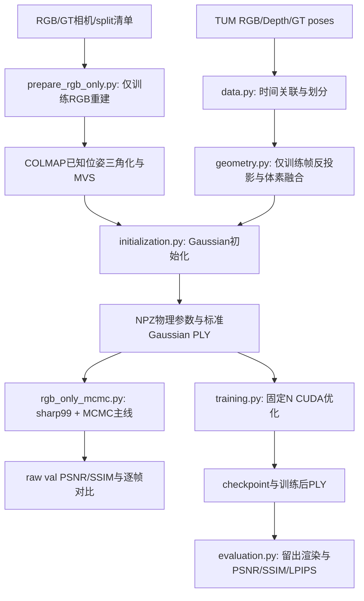

# mobile3dgs

面向手机端短程3DGS的研究项目。当前画质主线是 **RGB-only MVS → 20k Gaussian初始化 → sharp99监督 + MCMC CUDA训练 → raw留出视图评价**。保留RGB-D/固定N链路作对照，不包含手机App；相机仍为已知GT，而非本项目估计的SLAM位姿。

## 架构



- `src/mobile3dgs/data.py`：官方单序列下载、安全解压、SHA256指纹；RGB/深度一对一时间关联，各自在采集时刻插值GT位置与旋转，训练/测试划分。
- `src/mobile3dgs/geometry.py`：按深度时刻C2W反投影，再投影到RGB时刻相机双线性采样颜色，过滤背后/图外点后进行体素融合。验证/测试RGB和深度不参与几何构建。
- `src/mobile3dgs/initialization.py`：固定seed、无放回精确选N点；16-NN PCA法线、3-NN切向尺度；可选受几何尺度约束的多视图2×2切向核；导出SH0 Gaussian PLY。
- `src/mobile3dgs/rendering.py`：训练/评价共享的相机变换、物理参数激活、gsplat调用、checkpoint读取及PLY导出；仅在gsplat边界将OpenCV整数像素主点加0.5。
- `src/mobile3dgs/training.py`：固定N FP32 Adam、训练帧采样、L1/SSIM损失、原子checkpoint保存与断点恢复。
- `src/mobile3dgs/evaluation.py`：独立加载checkpoint，留出渲染、浮点指标、逐帧PNG与对比图。
- `tools/prepare_rgb_only.py`：训练RGB与已知相机的COLMAP CUDA三角化/MVS，将全部融合点直接接入现有初始化、训练及留出评价。
- `tools/rgb_only_mcmc.py`：保留r31的RGB-only MVS/SH0/MCMC训练设置；默认只评价raw val，保存带相机清单/来源指纹的模型，测试确认需显式调用。
- `src/mobile3dgs/__main__.py`：`fetch / prepare / init / train / evaluate`命令；`prepare`可再预留验证帧。拒绝覆写已有输出目录。
- `tests/test_pipeline.py`：时间/四元数、深度单位、测试泄漏、尺度单位不变性、表面对齐、PLY存储约定检查。
- `tests/test_fetch.py`：本地真实HTTP截断/坏压缩包与重试，确保失败下载不发布为可复用缓存；坏的旧缓存移回`.part`，下次调用重新下载，无自动重试循环。
- `tests/test_projection.py`：旋转/平移平面的解析协方差、深度不一致/图外剔除、测试视图隔离及方差裁剪上下界。
- `tests/test_desktop.py`：真实CUDA下旋转/平移相机的投影位置、RGB/alpha参数约定和全部参数组反向梯度。
- `tests/test_rgb_only.py`：真实CPU特征数据库中的相机/rig/frame/image ID及非平凡C2W变换投影检查。

CPU几何依赖NumPy、SciPy、Pillow；桌面训练使用PyTorch 2.8、gsplat 1.5.3、TorchMetrics。Conda统一管理Python和CUDA编译工具链，pip只安装到该Conda环境；不在base或原来的`.venv`混装。

## 快速运行

Linux/WSL2、NVIDIA CUDA GPU。环境使用Python 3.12与CUDA 12.8工具链；首次渲染会编译gsplat扩展，首次LPIPS评价会下载官方AlexNet权重，需要网络与磁盘空间。

`environment.yml`是简洁环境入口；`environment.resolved.yml`记录本次Linux环境实际依赖版本，可用其代替前者创建。它是版本快照，不是跨平台或带哈希的锁文件。项目包仍从当前仓库editable安装。

```bash
conda env create -f environment.yml
conda activate mobile3dgs
export CUDA_HOME="$CONDA_PREFIX"
export CPLUS_INCLUDE_PATH="$CONDA_PREFIX/targets/x86_64-linux/include${CPLUS_INCLUDE_PATH:+:$CPLUS_INCLUDE_PATH}"
export LIBRARY_PATH="$CONDA_PREFIX/targets/x86_64-linux/lib${LIBRARY_PATH:+:$LIBRARY_PATH}"
export MAX_JOBS=2  # 限制首次CUDA扩展编译并行度，避免占满主机内存。

# 仅下载freiburg1_desk，不下载全集；已有压缩包/数据目录会复用。
mobile3dgs fetch

# 从有效时间关联中均匀取50帧，其中每8帧一张留作测试。
mobile3dgs prepare data/raw/rgbd_dataset_freiburg1_desk \
  --output runs/desk/prepared --frames 50

mobile3dgs init runs/desk/prepared \
  --output runs/desk/baseline-20k --method baseline --count 20000

mobile3dgs init runs/desk/prepared \
  --output runs/desk/projection-20k --method projection --count 20000

python -m unittest discover -s tests -v
```

已有数据/初始化产物可跳过对应命令，重复实验请选择新输出目录。默认两种初始化均为seed42、相同点ID/颜色/opacity/初始法线/法向厚度；训练中N保持不变，没有自动增密/剪枝。候选点不足N就报错，不复制点凑数量。

## 固定N参考链路：桌面训练与评价

在上述Conda环境执行，两组使用相同训练参数和采样seed：

```bash
mobile3dgs train runs/desk/baseline-20k --output runs/desk/baseline-train --steps 3000
mobile3dgs train runs/desk/projection-20k --output runs/desk/projection-train --steps 3000

mobile3dgs evaluate runs/desk/baseline-train/checkpoint.pt --output runs/desk/baseline-eval
mobile3dgs evaluate runs/desk/projection-train/checkpoint.pt --output runs/desk/projection-eval

# 从中间checkpoint恢复到原定3000步，写新目录，不覆盖原实验。
mobile3dgs train --resume runs/desk/baseline-train/checkpoint_000500.pt \
  --output runs/desk/baseline-resumed
```

- 优化中心、log尺度、wxyz旋转、opacity logit和SH0，法线/薄面约束仅用于初始化，不在训练中锁死。SH0保持视角无关，不启用SH3、位姿优化、深度损失或外观网络。
- 全分辨率640×480、单视图均匀随机采样、固定N FP32 Adam；损失为$\mathcal{L}=(1-\lambda_{\mathrm{SSIM}})\mathcal{L}_1+\lambda_{\mathrm{SSIM}}(1-\mathrm{SSIM})$，默认SSIM权重0.2。只加载训练RGB；测试RGB仅由评价命令加载。
- 学习率：中心从`1.6e-4 m`指数降至百分之一，log尺度0.005、旋转0.001、opacity logit0.05、SH0为0.0025；Adam eps为1e-15。没有场景坐标归一化。
- `--steps`是**总步数**，不是额外步数；恢复默认沿用保存的总计划、seed、损失和采样器/优化器状态。可显式扩大总步数，但这会从恢复点改变中心学习率计划，记录在实验中，不与原计划的连续训练等价。拒绝缩短计划或已完成的空恢复。
- `--checkpoint-every`默认500，保留中间`checkpoint_XXXXXX.pt`；最终保存`checkpoint.pt`、`model.ply`、`training.json`和`trace.jsonl`。中断后可从最近完整checkpoint恢复，没有每步自动保存。
- checkpoint内嵌相机/split清单及初始化来源；只包含tensor/基础类型，使用`weights_only=True`读取。数据图像仍引用原数据路径，不随checkpoint打包。
- 评价默认`--split test`，也可`--split val`用于选型、`--split train`作诊断。全图、无mask、sRGB浮点范围0–1；预测clamp后计算PSNR、Gaussian 11×11/sigma1.5 SSIM、官方预训练AlexNet LPIPS，先算浮点指标再量化PNG。汇总是逐帧指标均值，不是先汇总MSE再转PSNR；完全相同图像的PSNR以JSON字符串`Infinity`表示。
- `metrics.json`包含逐帧/均值指标、原始checkpoint步数/来源、相机清单和运行版本。`renders/`导出渲染、`ground_truth/`导出参考，`comparison.png`左参考/右渲染。延迟先预热并CUDA同步，只计渲染，不计指标、传输和PNG；单次实测不是设备性能基准。


## 当前主线：RGB-only MVS + sharp99 + MCMC

`experiments/rgb-only-mcmc.json`固化`runs/analysis/r31-mvs-sharp99-mcmc`：seed42、20k初始点、opacity0.5、SH0、10,000步、MCMC上限200k。原始记录raw val PSNR为18.9411、SSIM为0.6949；这只是单场景/单seed基线，不是普适画质结论。`reference`保存历史输入指纹及指标，不会随候选结果自动改写。

**几何仍由37张训练RGB构建，99张较清晰图只用于训练监督**；不是99图重建，也不读取传感器深度。已有初始化来自`runs/analysis/rgbinit-mvs/`对MVS几何深度图的反投影、5mm体素融合及20k采样，不等同于下节首次试验的58,097点融合云。历史输入和权重保留不覆盖；运行前须保有配置指向的初始化、manifest及RGB数据。

`tools/fuse_mvs.py`把此初始化配方从历史分析目录移入版本控制，只读取train的几何MVS深度图。给定已有37图MVS产物，下面的检查已实际通过：所有初始化NPZ数组与冻结先验逐元素完全相等；重新运行COLMAP本身不保证逐位确定。

```bash
PYTHONPATH=src python tools/fuse_mvs.py \
  --prepared runs/rgb-only/desk/prepared --mvs runs/rgb-only/desk/mvs \
  --output runs/rgb-only/mainline/rebuilt37 \
  --reference runs/analysis/rgbinit-mvs/initialization/gaussians.npz
```

新入口完整复跑两次：`runs/rgb-only/mainline/{baseline-r31,baseline-r31-repeat}/`，同输入指纹、同源码、seed42，raw val PSNR分别19.0282和18.8266，均值18.9274；SSIM均值0.69446。两次都到200k，单次训练约154–157秒。约0.20dB的实测跨度说明固定seed仍不等于CUDA/MCMC逐位确定；两次样本不是置信区间，小幅指标波动不能当作改进。独立重载首个模型的全部val指标与保存记录完全一致，回归检查通过。

```bash
conda activate mobile3dgs
PYTHONPATH=src python tools/rgb_only_mcmc.py \
  --output runs/rgb-only/mainline/my-run

# 只从新模型中保存的相机清单重新评价，不再读取初始化目录。
PYTHONPATH=src python tools/rgb_only_mcmc.py \
  --evaluate runs/rgb-only/mainline/my-run/model.pt \
  --output runs/rgb-only/mainline/my-run-val

# 最终确认才显式读取test，不用于下一轮选型。
PYTHONPATH=src python tools/rgb_only_mcmc.py \
  --evaluate runs/rgb-only/mainline/my-run/model.pt --split test \
  --output runs/rgb-only/mainline/my-run-test
```

默认输出到新的`runs/rgb-only/mainline/measurement-*`；已有输出目录报错，不覆盖。`result.json`记录raw PSNR/SSIM、逐帧结果、N、训练耗时/显存、输入/源码指纹和运行版本；`val/*.png`为全部验证帧的左参考/右渲染。图像不随模型打包，移动数据需维护其路径。

训练前核对留出时间戳、相机和实际PNG内容指纹：复制图换路径允许，替换留出像素则拒绝；内容指纹核验不计算测试成绩，也不把留出图用于梯度监督。接受历史分析和正式COLMAP准备工具两种真实MVS来源标记，仍要求无传感器深度。

该入口不启用位姿/曝光拟合、去畸变、mono/depth loss或高阶SH，不生成aligned成绩。模型使用独立的`mobile3dgs-rgb-only-mcmc-v1`格式，由此脚本评价；不是固定N CLI的checkpoint，不提供训练恢复或PLY导出。相机加载及像素中心约定复用`rendering.py`，MCMC直接取得gsplat前向元数据；训练/评价共用同一渲染函数。

loss默认保持r31：$0.8L_1+0.2(1-\mathrm{SSIM})+0.01\,\mathrm{mean}(\alpha)+0.01\,\mathrm{mean}(s)$。训练配置可选`lambda_ssim`、`opacity_reg`、`scale_reg`三个数值字段，默认分别0.2、0.01、0.01；SSIM权重须在0到1之间，正则权重须有限且非负。有效权重补全写入`result.json`及模型的`config`，设置为0的项不参与计算。`lambda_ssim=0`只把光度项改成L1，不会自动关闭两个正则。

这里$\alpha=\mathrm{sigmoid}(\text{opacity logits})$，$s=\exp(\text{log scales})$；尺度正则对全部Gaussian及三个轴取均值，单位为未归一化的世界米。默认组合沿用gsplat v1.5.3的MCMC示例配方，但SSIM采用TorchMetrics实现，不是PocketGS训练loss的严格复现。

后续候选沿用本主线，先保持相机、留出图及评分不变，用raw val和逐帧画面筛选，再做独立确认；旧7张test已在探索实验展示过，不再宣称完全未见。

### 主线后续受控对照（已完成配对确认）

保持sharp99监督、GT相机、SH0、seed42、10,000步、opacity0.5与MCMC最终200k不变，做几何输入帧数×初始点数的2×2对照。每格完整训练两次，表中为同6张raw val的均值；没有使用test/aligned成绩选型。

| 几何输入 | 初始点数 | raw val PSNR ↑ | SSIM ↑ | 选择阶段结论 |
|---|---:|---:|---:|---|
| 原37图MVS | 20,000 | 18.9274 | 0.69446 | 冻结基线 |
| sharp99图MVS | 20,000 | 18.8372 | 0.69528 | 未超过0.25dB门槛，不保留 |
| sharp99图MVS | 50,000 | 18.7327 | 0.69016 | SSIM下降超过0.003，拒绝 |
| 原37图MVS | 50,000 | 19.2615 | 0.69414 | 初筛达标，但新配对确认失败，拒绝 |

原37图/50k候选初筛的表面收益主要集中在背景困难帧，前景细节仍模糊。随后重新配对运行原基线与候选各两次，仍使用相同6张raw val（这是新的训练复跑，不是独立图像留出集）：

| 新配对确认 | raw val PSNR ↑ | SSIM ↑ |
|---|---:|---:|
| 原37图MVS / 20k起点 | 18.9764 | 0.69526 |
| 原37图MVS / 50k起点 | 18.8973 | 0.69164 |

确认阶段候选PSNR下降0.0791dB，SSIM下降0.00363，超过预设0.003退化界限，因此不保留。50k候选四次运行记录的配置、初始化、清单及源码指纹完全相同，不能把初筛上涨当作可靠改进。**最终仍保留原r31主线：37图MVS、20k起点、sharp99监督、MCMC最终200k；未确认任何画质提升。**

99图重建实际约1233秒、产生更多几何候选，但没有可靠画质收益。全部模型、逐帧对比和确认结果保存在`runs/rgb-only/mainline/`，不覆盖旧产物。完成3个候选（每个两次）及4次新配对确认后，按连续3个候选未保留停止搜索；没有消耗第4个候选名额。测试图已在历史实验展示过，本轮未用于选型，也不声称跨场景泛化。

优化参数和逐次结果记录在`.context/compound-engineering/ce-optimize/rgb-only-mcmc/{spec,experiment-log}.yaml`；旧r31及冻结配置不覆盖。

### Loss受控消融（四版本均未保留）

固定原37图MVS、20k起点、sharp99监督、GT相机、SH0、seed42、10,000步和MCMC上限200k，只改变三个loss权重。新基线和每个候选各完整训练两次，全部达到200k；以下为相同6张raw val的均值，不与前节不同轮次的基线混算。

| 版本 | `(lambda_ssim, opacity_reg, scale_reg)` | raw val PSNR ↑ | SSIM ↑ | 结论 |
|---|---|---:|---:|---|
| 当前主线 | `(0.2, 0.01, 0.01)` | 18.9018 | 0.69308 | 保留 |
| 去掉两个正则 | `(0.2, 0, 0)` | 18.6608 | 0.68666 | SSIM退化，拒绝 |
| 仅去opacity正则 | `(0.2, 0, 0.01)` | 18.6711 | 0.68583 | SSIM退化，拒绝 |
| 仅去scale正则 | `(0.2, 0.01, 0)` | 18.8947 | 0.69362 | 差异未超过噪声门槛 |
| 纯L1光度项，保留两个正则 | `(0, 0.01, 0.01)` | 18.9763 | 0.68384 | SSIM退化，拒绝 |

预设PSNR改善门槛为0.25dB，SSIM最大退化为0.003。去两个正则、去opacity、纯L1的SSIM分别下降0.00642、0.00726、0.00925；纯L1的PSNR仅上升0.0745dB，不能据此认定更好。去scale的PSNR差为−0.0071dB，不能证明收益或等价性。**没有候选通过筛选，因此未追加新的训练配对确认；最终仍保留原默认loss，没有确认新的画质收益。**

已查看四个候选首轮的全部6张验证帧缩略对比：前景细字/线缆模糊及frame64的背景拖影仍在，原尺寸PNG均保留。选择与报告使用同一场景的同6张验证图，不是独立图像留出验证；本轮不使用test、aligned或LPIPS选型，也不声称跨场景泛化。

结果保存在`runs/rgb-only/loss-sweep/`的`baseline-{a,b}`、`no-regularizers-{a,b}`、`no-opacity-{a,b}`、`no-scale-{a,b}`及`l1-photometric-{a,b}`。每个候选保存有效`config.json`、模型、逐帧结果及PNG；例如用`--config runs/rgb-only/loss-sweep/no-scale-a/config.json --output 新目录`可复跑该候选，但CUDA/MCMC复跑不保证逐位相同。`experiments/rgb-only-loss.json`保留显式默认权重的对照配置，不替换冻结的`rgb-only-mcmc.json`。

逐次日志和方案在`.context/compound-engineering/ce-optimize/rgb-only-loss/{spec,experiment-log}.yaml`；本节是随代码保留的结果报告。共10次完整训练，3个拒绝、1个无定论、0个保留，按4个候选上限停止；训练段计时合计约23.8分钟，没有新增依赖或外部实验/评分调用。

验证：全套21项检查通过；原默认loss及另外五组权重的float64 CPU数值/梯度与参考公式逐项完全相同。10个实际模型的参数均有限，训练步数、点数和有效loss配置与结果记录一致；独立重载`l1-photometric-b/model.pt`后，全部val均值及逐帧指标与训练后记录完全一致。初始化NPZ、manifest、runner和`rendering.py`的记录指纹在各次对照中保持一致；未修改冻结输入或旧r31产物。

### 训练位姿联合优化快速对照（已完成探索性筛选）

原主线不改。固定37图MVS/20k起点、sharp99监督、SH0、当前loss、seed42和200k上限，比较固定相机、直接联合、分阶段联合、交替优化、特征BA约束联合五组；各10,000次渲染/反传，先各一次，只作探索性筛选。PSNR改善超过0.25dB且SSIM下降不超过0.003时，才追加基线/最佳候选各一次，不自动替换默认。

训练相机学习局部刚体增量，首个训练相机固定；相机Adam学习率`1e-4`，位姿先验权重`1e-3`，平移/旋转先验尺度1cm/0.5°，硬限幅3cm/2°。分阶段法前1000步固定相机、中间6000步联合、最后3000步冻结已学相机继续更新Gaussian；交替法中段每5步Gaussian-only/5步camera-only，因此总计7000次Gaussian更新、3000次相机更新，不宣称与其他组Gaussian更新数相同。

特征法采用分阶段调度，加训练特征重投影Huber项（delta2px、权重`1e-3`），同时优化稀疏点；复用已有99图稀疏模型的18,517点、95,641条观测，不重跑MVS、不替换原Gaussian初始化。99张训练图的RGB内容、相机、内参均已核对一致，稀疏点轨迹不含留出图。所有组只用固定原相机的6张raw val评分，不拟合验证位姿，不使用aligned分数。

实验实现、运行协议、输入核验及逐次结果单独保留在`runs/rgb-only/pose-quickcheck/`；这是参数尚未调优的快速方法对照，不是已验证的生产功能或最终几何精度结论。

运行前检查：实际渲染的相机梯度与有限差分方向相符（余弦约0.995、相对差约13%，不是逐项精确梯度验证）；特征BA及交替模式均完成20步真实训练、固定相机验证和模型保存，首步loss与固定相机基线一致。完整对照仍需以最终raw指标和画面判断，而不是以相机发生移动或训练loss下降判断。

五组均完成10,000步且达到200k，以下是各单次运行在同6张固定相机val图上的均值，不是多次复跑均值：

| 方法 | raw PSNR ↑ | SSIM ↑ | raw LPIPS ↓ |
|---|---:|---:|---:|
| 固定相机基线 | 19.0560 | 0.69918 | 0.28446 |
| 直接联合优化 | 17.4770 | 0.63949 | 0.27069 |
| 分阶段联合优化 | 17.6118 | 0.64541 | 0.26598 |
| 交替优化 | 17.6484 | 0.64644 | 0.27432 |
| 特征BA约束＋联合优化 | 17.7165 | 0.64780 | 0.26275 |

四组均未通过预设raw PSNR/SSIM门槛，因此未追加配对训练复跑、不替换原主线。LPIPS是看到部分细节更清晰、但PSNR下降后追加的探索性诊断，不是预先选择指标；沿用现有官方预训练AlexNet及浮点评价约定，没有拟合验证位姿，也不按PNG量化图计分。五个保存模型重新渲染的原始逐帧PSNR均与各自记录一致。

四组的全部6帧缩略对比均已查看，部分前景文字、键盘和线缆更清楚，但背景拖影仍在。四组LPIPS均下降，与局部感知细节改善的观察一致；不能把PSNR下降解释成所有画质维度都退化，也不能把LPIPS下降解释成真实几何精度已提高。

对全部99张训练图补做固定模型、无新增优化的拟合检查：

| 模型／使用的训练相机 | 训练PSNR ↑ | 平均光度项（不含正则）↓ |
|---|---:|---:|
| 基线／原相机 | 22.7018 | 0.07448 |
| 直接联合模型／原相机 | 20.1302 | 0.10086 |
| 直接联合模型／已学训练相机 | 24.5517 | 0.06096 |

这说明联合模型更依赖调整后的相机：训练拟合改善，不等于原相机下的新视角一致性改善。直接联合组的训练位姿修正中位数约7.53mm/0.364°；仅由训练相机估计全局刚体校正后，位姿差残差几乎不下降，不支持把变化主要解释为单一全局刚体偏移。此校正没有应用到模型或评价相机。

这些结果只覆盖当前先验强度、学习率和调度，且每种方法仅一次；交替组的Gaussian和MCMC噪声更新数也更少。仅凭上述RGB分数和训练拟合结果不能判断真实几何，另见下节的冻结模型可见表面复评。完整外观结果在`results.json`，追加诊断在`quality-diagnostics.json`，各组模型与原尺寸对比图均保留在上述实验目录。

最终核验：五个模型的参数与物理尺度有限、尺度为正、旋转四元数非零；四个优化组的训练相机索引、首相机锚定及位姿限幅均通过检查，原相机manifest保持一致。候选共用同一实验实现指纹，基础渲染/主线代码及初始化指纹一致；模型和结果SHA256已记录。共5次完整训练、2次20步冒烟，训练段合计约17.9分钟，未重跑MVS、未新增依赖、未追加配对训练；原主线代码和默认配置未修改。

### 可见表面几何复评

`tools/geometry_eval.py`只加载冻结模型，不重训。TUM传感器深度仅用于评价：独立重建RGB/深度关联及各自时刻GT位姿，按深度时刻的光学相机渲染，深度PNG除以5000转米。固定原GT世界坐标与尺度，不做ICP、缩放或验证位姿拟合。参考有效范围为0.2–4m，只评分原有6个val对应的深度图，不读取train/test深度像素参与评分。

主表面代理为沿投影Gaussian中心深度累计opacity首次达到0.5的5mm分箱深度，量化误差不超过约2.5mm；不是Gaussian中心点云、混合期望深度或真实mesh表面。累计opacity不足0.5或深度越界计为缺失。深度2/5cm命中率以全部有效参考像素为分母；10cm截断误差对缺失像素记10cm，条件MAE/中位数/P90必须与覆盖率一起看。点云仅由这些已知可见射线的代理深度反投影，5mm体素质心后比较双向距离及2/5cm F-score。

跨视图使用参考深度确定重叠：GT点投到另一相机，最近像素的参考深度差不超过3cm才建立对应，再比较两个预测表面点的世界坐标；缺失计入对应覆盖与命中率。GT与GT本身的对应误差同时报告，作为传感器噪声/离散化参考下限，不宣称独立的无真值自一致性验证。额外报告中心深度q10–q90层间跨度、Gaussian最小轴标准差及未条件化的相机Z轴标准差；后者可能来自倾斜薄片的切向范围，不直接当成几何误差。

```bash
R=runs/rgb-only/pose-quickcheck
PYTHONPATH=src python tools/geometry_eval.py \
  --manifest runs/analysis/manifest-sharp.json \
  --model baseline-a="$R/baseline-a/model.pt" \
  --model joint-a="$R/joint-a/model.pt" \
  --model staged-a="$R/staged-a/model.pt" \
  --model alternating-a="$R/alternating-a/model.pt" \
  --model feature-ba-a="$R/feature-ba-a/model.pt" \
  --output runs/rgb-only/geometry-reeval/five-models
```

输出包含事先固定的`protocol.json`、输入/源码SHA256、逐帧参考与预测NPZ、每模型`metrics.json`、汇总`results.json`和统一色标的原像素深度/误差图。目录必须不存在，避免覆盖旧产物。评价器的解析/真实CUDA反例涵盖正确平面、局部错位、缺失、双层及厚Gaussian；不能用删面提高条件误差、把两层期望深度当表面，或用中心深度掩盖大尺度Gaussian。

这是局部、含噪的已观测表面参考，不是完整场景独立扫描真值：未观测区域、被不透明层遮住的额外几何和精确mesh拓扑均未验收。六个val也已用于之前的外观诊断，结果不能当成新场景或独立留出泛化证明。

#### 本轮结果：五组冻结模型，各一次

产物在`runs/rgb-only/geometry-reeval/five-models/`。五组共30次640×480视图评价，完整CLI耗时62.21秒，无新增训练；6帧有效参考像素合计1,320,383，占原图像素71.64%。下表深度误差按全部帧的有效且预测覆盖像素汇总，不是逐帧均值；覆盖率以全部有效参考像素为分母，点云F-score为上述局部可见代理云的双向指标：

| 方法 | 深度MAE cm ↓ | 深度中位 cm ↓ | 深度P90 cm ↓ | F-score 2cm % ↑ | F-score 5cm % ↑ | 跨视图差中位 cm ↓ | 覆盖率 % ↑ |
|---|---:|---:|---:|---:|---:|---:|---:|
| 固定相机基线 | 10.91 | 2.95 | 33.27 | 48.91 | 67.97 | 2.22 | 99.50 |
| 直接联合 | 10.48 | 2.75 | 28.41 | 49.07 | 68.44 | 1.99 | 99.52 |
| 分阶段联合 | 10.61 | 2.75 | 28.59 | 50.00 | 68.79 | 2.01 | 99.32 |
| 交替优化 | 10.06 | 2.67 | 27.55 | 50.50 | 70.46 | 1.95 | 99.72 |
| 特征BA＋联合 | 9.52 | 2.61 | 26.07 | 51.15 | 70.57 | 1.94 | 99.25 |

**本轮不能按PSNR下降否定几何收益。** 特征BA组的6帧深度MAE均低于基线；四种候选的逐帧深度中位误差也均改善。特征BA及交替组最值得继续作几何目标下的确认，但并非所有指标都同向：直接联合的点云预测→参考平均距离从9.05cm变为9.38cm，分阶段的参考→预测平均距离从6.07cm变为6.18cm。没有重复训练、独立新场景确认或自动替换主线，也不能据此断言原GT位姿错误。

为排除覆盖差异和5mm分箱造成的假收益，追加了**事后稳健性诊断**，未修改预先固定的主指标：取五组共同预测覆盖的1,305,625个像素（保留98.88%参考），特征BA的MAE仍从基线10.58cm降到9.30cm。只考虑±2.5mm轴向量化误差时，其MAE最坏界9.55cm仍低于基线最好界10.33cm；这不是统计显著性、传感器精度或泛化界。独立NumPy实现从保存NPZ重算350个主数值字段，与原JSON差异全部为0；检查了210个预测数组的形状、有限值、缺失约定和分位数顺序。明细保存在`saved-map-audit.json`。

主要短板仍是远处表面：按GT深度预设的2–4m分区，基线MAE为38.12cm、特征BA为31.97cm，5cm深度命中率仅14.13%与17.47%；0.2–1m近区对应命中率为90.16%与92.78%。已检查全部6帧基线/特征BA误差总览，frame64/82及远背景的大误差仍明显，不能把局部前景改善说成完整几何已可靠。`overview-baseline-feature-ba.png`是缩略总览；各`comparison-XXXXXX.png`保留统一色标的原像素面板，洋红表示参考有效但预测缺失，灰色为参考未知。

15对视图共有680,934个参考对应。GT对GT的跨视图差本身中位为1.39cm、P90为2.66cm，只有71.61%落在2cm内；预测结果须相对此离散/传感器参考解读，不能把对应误差全部归于模型。特征BA的中心深度q10–q90跨度中位仍为8cm，说明opacity的前后深度混合未消失，不等于真实表面有8cm厚。

最终验证：全套33项检查通过，含新增的12项CPU/真实CUDA几何有效性检查；补充的低总opacity双层反例验证了绝对0.5阈值与条件中位数不能混用。评价器只读复核没有发现可操作的实现缺陷；训练主线、默认loss、相机、输入与五个模型均未修改。后续应保留原主线，将特征BA和交替作为候选，先预注册几何门槛并配对复跑，再针对远处MVS支持和训练RGB多视图几何约束改进，而不是继续仅按PSNR选型。

验证证据汇总为同目录`validation.json`，完整只读代码复核回执为`review-receipt.json`：正确性、测试、维护性、性能及对抗检查均完成，无可操作缺陷。跨模型检查因本机缺少`jq`在审查前跳过，未安装新依赖，采用本地对抗复核替代；不宣称获得不同模型的交叉佐证。

### Pose-align外观复评

冻结`pose-quickcheck`的baseline、joint、staged、alternating、feature-ba五个模型，在同6张原val上分别从零增量进行相机拟合；不更新Gaussian、训练位姿、曝光或内参，不读传感器深度，不使用test。原raw分数保留，aligned分数只能解释为“给定目标RGB后的位姿细化”，不替换前节固定GT坐标的几何评价。

复用历史`runs/analysis/exp.py::evaluate`的模式：每图200步Adam、学习率`1e-3`，最小化未裁剪浮点渲染与目标RGB的L1；没有位姿先验或硬限幅。只报告最后一步，不按PSNR挑中间最优点，不多起点搜索。变换为`W2C_new = W2C_original @ inverse(delta)`，即`C2W_new = delta @ C2W_original`的世界坐标刚体修正；相机中心位移由前后C2W实际计算，不把增量中的平移参数范数误当成相机移动。

PSNR、SSIM和LPIPS统一在裁剪至0–1的浮点图像上计算；LPIPS沿用TorchMetrics预训练AlexNet、`normalize=True`，不按PNG评分。每组分数为6帧等权均值，原始分数先与已有逐帧记录核对。研究脚本与产物保留在`runs/rgb-only/pose-align-eval/`，不接入默认训练入口：

```bash
PYTHONPATH=src python runs/rgb-only/pose-align-eval/evaluate.py \
  --output runs/rgb-only/pose-align-eval/measurement
```

输出目录须不存在。各组PNG按“目标／raw／aligned”排列，逐帧JSON保存完整原始／对齐相机、6D增量、实际中心位移、旋转和L1轨迹；总表记录源码、RGB及checkpoint指纹，并检查GPU上的Gaussian参数逐位未变、梯度未写入。无约束相机拟合可能补偿模型形状误差，因此即使aligned分数提高，也不能解释为原GT位姿错误或冻结模型的几何得到改善。

#### 本轮pose-align结果

五组各6帧、每帧200步，共6000次相机更新，评价段计时176.77秒，无Gaussian重训。以下是同6帧等权均值；raw先与已有PSNR/SSIM/LPIPS逐帧记录核对通过，aligned使用最终一步：

| 方法 | raw PSNR ↑ | aligned PSNR ↑ | raw SSIM ↑ | aligned SSIM ↑ | raw LPIPS ↓ | aligned LPIPS ↓ |
|---|---:|---:|---:|---:|---:|---:|
| 固定相机基线 | 19.0560 | 20.1925 | 0.69918 | 0.73176 | 0.28446 | 0.27617 |
| 直接联合 | 17.4770 | 20.9336 | 0.63949 | 0.76771 | 0.27069 | 0.24159 |
| 分阶段联合 | 17.6118 | 20.9580 | 0.64541 | 0.76608 | 0.26598 | 0.23891 |
| 交替优化 | 17.6484 | 20.8282 | 0.64644 | 0.76267 | 0.27432 | 0.24909 |
| 特征BA＋联合 | 17.7165 | 21.0457 | 0.64780 | 0.76717 | 0.26275 | 0.23501 |

四个候选在pose-align条件下的平均PSNR均超过同样对齐的基线，排序与raw不同。特征BA的aligned PSNR和LPIPS最好，直接联合的SSIM略高；本次单模型比较不能证明细小差距稳定。特征BA相对aligned基线的PSNR高0.8532dB，6帧中5帧PSNR更高、全部6帧SSIM更高且LPIPS更低。例外frame64仍是严重失败视角：特征BA aligned PSNR为14.2298dB，低于基线14.6699dB，不能只看均值宣布全面改善。

实际相机中心位移中位数在五组间为10.71–11.59mm，旋转中位数为0.609–0.731°；所有30帧的最大位移26.47mm、最大旋转1.123°。这些不是外部相机真值测量，而是每个模型分别根据目标RGB拟合出的修正，不能据此断言原GT相机有同样大小的误差。

已查看五组全部6帧的“目标／raw／aligned”缩略总览：候选前景的书本、键盘及线缆已有细节在对齐后更贴近目标位置，frame64的背景熔化和拖影仍在。各组`overview.jpg`为缩略图，`XXXXXX.png`为原尺寸三联图；pose-align只改变观察相机，不会生成原模型没有的细节。

产物在`runs/rgb-only/pose-align-eval/measurement/`，完整指标和相机在`results.json`及逐帧`*-pose.json`。五个checkpoint前后SHA256一致，GPU上的全部Gaussian参数逐位不变且未写入梯度，RGB内容及原manifest指纹不变。独立NumPy相机组合／逆矩阵误差均小于`5e-7`，汇总指标重算误差小于`4e-15`；重载特征BA的6个保存aligned相机重新渲染后，全部PSNR/SSIM/LPIPS与记录差异为0，证据见`audit.json`和`reload-proof.json`。

结论限定于目标RGB条件下的可对齐外观：不能继续仅凭raw下降判定候选整体画质更差，也不能把aligned收益当成冻结模型新增了几何。原始raw结果、固定GT几何评价、默认训练配置及旧模型均保留，不自动替换主线。

### 几何优先消融：已停止，未选定新主线

`experiments/geometry-accuracy-study.json`预注册了8组10,000步对照：参考特征BA＋联合训练、密集邻域法线、深度分层种子、关闭MCMC位置噪声、两档MVS深度约束、深度＋方差约束及低初始opacity。所有候选使用`tools/pose_align_eval.py`评价冻结模型的pose-align外观；`tools/geometry_eval.py`仍在固定GT坐标下评价几何，不使用模型专属相机拟合。

seed42筛选赢家为MVS深度权重0.3，5cm命中率从66.15%到69.28%，2cm命中率从42.36%到46.08%；这是本场景的单seed筛选，不是已确认的新主线。seed43的参考／候选配对也已完成；随后按用户要求取消后台批次，不再训练seed44，因此未满足预注册三seed确认条件，也没有最终选型。停止状态和筛选数据保存在`experiments/geometry-accuracy-results.json`；完整模型、逐帧指标和相机在`runs/rgb-only/geometry-accuracy-study/`。

研究训练器为`tools/train_geometry.py`，初始化对照为`tools/study_initialization.py`，调度器为`tools/run_geometry_study.py`。MVS教师仅来自原37张TRAIN RGB图估计的深度，其中29张不在sharp99中，不能只监督重合的8张；传感器深度只用于独立几何评价。45项检查和真实CUDA短跑通过，训练器／pose-align实现已与旧研究脚本对照。计时为桌面GPU实测，不含已缓存MVS的构建成本，不代表手机表现。默认配置与旧基线均未替换；当前转向数字图像处理驱动的架构研究，未授权继续训练。

## RGB-only首次试验：已知相机三角化与MVS

`tools/prepare_rgb_only.py`只用RGB、共享内参和已知C2W位姿构建先验：训练图SIFT/匹配 → 固定位姿三角化 → COLMAP PatchMatch MVS/几何融合 → 复用现有Gaussian初始化、训练和评价。MVS会**估计**深度，但不读取传感器深度PNG，不使用原RGB-D融合云，也不把val/test图像送入几何重建。没有稀疏/随机回退或20k截断。

在上述Conda环境中运行；旧环境需补齐这两个已固定版本的pip依赖，不能无约束升级`cuda-toolkit`替换Torch的CUDA运行库：

```bash
conda activate mobile3dgs
python -m pip install pycolmap-cuda12==4.2.1 cuda-toolkit==12.8.1

# 复用后文验证协议已生成的RGB/相机/split清单；换新目录以免覆写实测产物。
R=runs/rgb-only/desk-rerun
PYTHONPATH=src python tools/prepare_rgb_only.py \
  --manifest runs/quality/prepared-v2/frames.json --output "$R"
mobile3dgs train "$R/initialization" --output "$R/train" \
  --steps 10000 --checkpoint-every 10000
mobile3dgs evaluate "$R/train/checkpoint.pt" --split val --output "$R/val-eval"
mobile3dgs evaluate "$R/train/checkpoint.pt" --split test --output "$R/test-eval"
```

输入清单只需`dataset/intrinsics/image_size/frames`；帧包含`timestamp/rgb/split/c2w`。本次复用的50帧最初由RGB-D时间关联选出，**不是新的独立RGB选帧协议**；本脚本只读取其中RGB与相机字段，并导出无传感器深度字段的`rgb-input.json`。复制的50张RGB供后续训练/评价使用，`train-images/`及特征数据库只包含37张train。生成的schema3清单与`initialization/`直接接现有`train/evaluate`；通用`prepare/init`仍是schema2 RGB-D路径，不宣称支持schema3投影初始化。

实测`runs/rgb-only/desk/`：37训练/6验证/7测试、640×480、固定TUM GT相机、seed42、SH0、10,000步。COLMAP 4.2.1 CUDA得到3,544个稀疏点、58,097个MVS融合点，全部初始化并在训练中保持固定N。稀疏模型位姿与输入逆C2W最大矩阵误差为`1.11e-15`，稀疏重投影误差中位数1.631px、P90为2.513px；转换后COLMAP主点为`320,240`，MVS后内参不变。

| 初始化来源 | Gaussian数 | 验证PSNR ↑ | 验证SSIM ↑ | 验证LPIPS ↓ | 测试PSNR ↑ | 测试SSIM ↑ | 测试LPIPS ↓ |
|---|---:|---:|---:|---:|---:|---:|---:|
| 修正后RGB-D baseline | 20,000 | 17.8343 | 0.6624 | 0.3406 | 20.1274 | 0.7144 | 0.3042 |
| RGB-only COLMAP MVS | 58,097 | 17.4483 | 0.6538 | 0.3778 | 19.1925 | 0.6953 | 0.3420 |

RGB-D参考为`runs/quality/measurement-1793933284015342015/`，不是旧像素约定下的历史模型；两组图像、划分、优化设置和指标定义相同，但**点数和几何构建预算不同，不是同点数消融**。这版虽然点数更多，画质没有提升，图中仍有细节模糊和背景缺失；不能仅凭这次对照把差异归因于深度输入、点数或某个几何误差。位姿是GT而非SLAM估计；仍沿用当前525针孔近似内参，未新增RGB畸变模型或位姿优化。仍不是手机端全链或PocketGS结果复现。

RTX 4060 Laptop上本次几何+初始化347.24秒（计时从RGB复制后开始），训练111.91秒（包含checkpoint I/O，参考保存间隔3000步，本次10000步，故也不是严格计时消融）；PyTorch训练峰值allocated约137.81MiB，不含COLMAP或全进程显存，不能当设备总占用。`reconstruction.json`、`geometry-audit.json`、`train/training.json`、`{val,test}-eval/metrics.json`和`result.json`保留来源与实际记录；`comparison.png`只展示该split第一帧，左参考/右渲染，并非全部帧拼图。完整16项检查通过，包括真实CUDA前后向与真实COLMAP特征数据库的已知位姿投影检查。

## 数据与坐标

官方来源：[TUM RGB-D下载](https://cvg.cit.tum.de/data/datasets/rgbd-dataset/download)、[格式/标定](https://cvg.cit.tum.de/data/datasets/rgbd-dataset/file_formats)。请引用TUM数据论文并遵守数据使用条款；下载数据、虚拟环境、运行产物均不进Git。

- 序列：`rgbd_dataset_freiburg1_desk`；RGB/Depth为640×480。
- 深度PNG除以5000转米，0为无效；默认最大深度4m、每4像素采样、5mm体素。
- 位姿来源为motion-capture GT，不是本项目估计的SLAM；只检验初始化，不能据此宣称手机估计位姿下的全链效果。
- RGB/深度时间差最多20ms，一对一最近配对；分别在RGB和深度时间插值GT，任一时刻的相邻GT间隔超过100ms就丢弃，不做位姿外推。
- TUM源四元数`xyzw`；内部C2W采用光学相机x向右/y向下/z向前、世界米制。
- 默认内参`525,525,319.5,239.5`采用TUM针对预注册深度推荐的ROS默认参数，不擅自单独去畸变；可用`prepare --intrinsics FX FY CX CY`显式覆盖。图像不缩放。
- 当前`prepared/frames.json`为schema2，分别保存RGB的`c2w`与深度时刻的`depth_c2w`；二者均指RGB光学坐标系，后者不是IR相机外参。深度一致性在深度时刻相机下查询，投影尺度仍在RGB时刻相机下计算。旧schema1先验不会被新`init`静默复用，需重新prepare到新目录；旧数据与模型保留不覆盖。
- 原始物理内参保持OpenCV/TUM整数像素中心约定；训练配置和评价结果记录gsplat边界的`intrinsics_pixel_offset=0.5`。旧checkpoint若缺少匹配约定，当前读取器会明确拒绝，不静默转换或续训；历史数值使用对应旧源码复现，新实验从头训练。
- 体素平均是共同几何基线，不是边界保持融合：可能混合近邻薄面。此阶段不声称改进了PocketGS的MVS。

## 两种初始化

`baseline`是PocketGS**结构重实现**：16-NN PCA、3-NN平均欧氏距离，切向圆核；不声称原作者代码复现。默认厚度比`--normal-ratio 0.1`是显式实验选择，PocketGS v6未核实该比例数值；opacity统一0.1，高阶SH未启用。

`projection`保持同一批中心与初始法线，只改切向核：

$$
F_i=\frac{1}{|V_i|}\sum_{v\in V_i}(J_{vi}U_i)^T(J_{vi}U_i),\quad
H_i=\frac{s_{t,i}^{2}F_i}{\gamma^2},
$$

$$
D_i=[(1-\beta)I+\beta H_i]^{-1},\quad
C_i=s_{t,i}^{2}\operatorname{clip}_{\mathrm{eig}}(D_i,0.25,4).
$$

默认`--beta 0.5 --gamma 1 --views 4`；`beta=0`回到基线。支持视图是训练序列中均匀间隔的最多4帧，不是每点全视图最优选择。需要深度非零、投影在图内、深度差不超过`0.03m+0.02*z`、法线/视线绝对夹角余弦至少0.15。该规则是启发式，不是校准的遮挡或不确定性模型；无支持点回退原尺度。

裁剪限制相对**方差**为0.25–4，即尺度为0.5–2倍。它不保证表面完整覆盖；也未实现后来讨论的冲突检测、中心重分配或联合优化。PCA没有置信法线自适应或低eigengap剔除。这些限制不能靠命名成新方法掩盖。

## 产物及接入边界

```text
runs/desk/
  prepared/
    frames.json          # split/相机/数据路径/几何设置
    cloud.npz            # xyz[m], rgb[0,1]，仅训练帧融合
  baseline-20k/          # projection-20k/结构相同
    gaussians.npz        # 物理参数、点ID、法线、支持数
    init.ply             # 二进制little-endian Gaussian PLY
    experiment.json      # 方法/设置/回退数/CPU初始化时间，training_performed=false
```

`gaussians.npz`：`means[N,3]`世界米制、`scales[N,3]`正标准差、`quats[N,4]`为wxyz、`opacities[N]`为物理alpha、`colors[N,3]`为0–1RGB，另有`point_ids/support_views/normals`。

`init.ply`与训练后的`model.ply`：`scale_0..2`为log标准差，`opacity`为logit，`rot_0..3`为wxyz，`f_dc_0..2`为SH0。不是普通RGB点云。gsplat调用接收物理尺度/alpha，内部负责激活，禁止外部重复exp/sigmoid。训练后PLY直接保留raw参数，避免饱和alpha经sigmoid/logit往返溢出。SH3加载器可能需要阶数适配；本项目桌面路径从NPZ初始化、从checkpoint恢复，不依赖外部PLY加载器。未验证Brush导入。

## 已执行验证

本次真实desk数据：压缩包344,011,403字节，本地SHA256：

```text
e983d6830916e66dc4a46a71368046b149b283de87769690e7aa4e0b9483530c
```

这是本地指纹，不是与作者公布checksum比对的认证。

初始默认命令得到50帧（43训练/7测试）、472,727个融合候选点；两组均20,000个Gaussian，投影组7,146个无支持点回退。初始化成功本身不能证明新视角质量提升。没有手机部署或中心联合重分配。

Conda环境中11项检查全部通过，包括真实CUDA前后向。初始化阶段已核验重新prepare的融合云逐元素一致、`projection --beta 0`物理参数精确回归baseline、PLY/SH0往返及无支持点回退。

### 桌面实跑：desk，固定20k，3000步

同一RTX 4060 Laptop GPU、43张训练/7张留出、640×480、SH0、seed42；没有用测试指标选超参数。两组的`metrics.json`保存在`runs/desk/{baseline,projection}-eval/`：

| 初始化 | 留出PSNR ↑ (dB) | 留出SSIM ↑ | 留出LPIPS-Alex ↓ |
|---|---:|---:|---:|
| baseline | 19.7041 | 0.7105 | 0.3596 |
| projection | 19.6611 | 0.7140 | 0.3398 |

这是单序列、单seed的链路验证，不是论文结果：投影方法没有带来PSNR提升，不能宣布全面优于baseline。对比图仍可见细节模糊；固定20k、SH0、3000步只构成当前受控训练设置，不代表已调优的高质量3DGS上限。

已实际从baseline第2500步checkpoint恢复到3000步：采样器最终状态、对应日志帧ID/学习率与完整训练一致，Adam各组步数为3000、N仍为20k。第一张留出帧的恢复/连续训练渲染MAE为`7.72e-5`（0–1 RGB）；CUDA浮点/原子累加不承诺参数逐位相同。恢复验证产物在`runs/desk/baseline-resumed-cpu-load/`。

## 固定20k画质优化的验证协议

禁止对上述7张测试帧反复选超参数。可从原训练帧再留出验证帧，**先划分再融合**：

```bash
mobile3dgs prepare data/raw/rgbd_dataset_freiburg1_desk \
  --output runs/quality/prepared-v2 --frames 50 --test-every 8 --val-every 8
PYTHONPATH=src python tools/quality_benchmark.py
# 独立确认当前候选，不能用其结果生成下一轮调参方案：
PYTHONPATH=src python tools/quality_benchmark.py --holdout
```

默认`--val-every 0`保持旧划分行为；启用后，在选中帧序列每周期中点将原train标为val，不改test。该50帧协议仍为37训练/6验证/7测试；旧schema1先验为418,737点，时序修正后的schema2为411,611点。相同50张图、时间戳、RGB相机和split未变；val/test的RGB和深度不进入几何或初始化支持视图。`evaluate --split val`独立导出验证渲染。

`experiments/desktop-quality.json`记录初始化CLI参数与训练参数。每次测量都重新初始化、训练和计算浮点指标，不重用旧模型；唯一输出目录在`runs/quality/measurement-*`。训练/评价日志重定向到文件，标准输出只包含测量JSON；每轮即时保存`result.yaml`（JSON兼容YAML），确认结果单独保存。指标定义保持不变；渲染约定从checkpoint的实际训练配置读取。

当前保留的画质预设是**baseline、20k、从头训练10,000步**，只延长训练总计划，不增加点数或启用增密。归一化到总步数的中心学习率计划随之重定时；不要把旧3000步模型继续到10,000步当作同一实验。普通`train`命令未指定`--steps`时仍默认3000步，便于快速检查；要使用保留的训练设置，显式传`--steps 10000`或运行上述质量测量命令。更长训练有实测画质收益，也增加训练时间，不是免费提速。

本轮控制基线：20k、SH0、3000步、seed42，在6张val上PSNR 17.5968、SSIM 0.6640、LPIPS 0.3850。它与旧43训练/7测试的19.7041不能直接比较。最差验证帧28存在明显背景覆盖缺失：alpha低于0.1的像素约占7.48%，贡献该帧47.43%的平方误差，说明不能只靠延长训练解释所有模糊。

基线和优化审批/实验台账位于被Git忽略的`.context/compound-engineering/ce-optimize/desktop-quality/`。7张test曾在前期展示过，不是全新未见数据；本轮不用于候选选型。该协议仍是单场景/单seed试验，不代替独立数据集验证。

最终原始版本/保留版本的成对确认、资源代价、逐帧退化与候选取舍见[固定20k优化实测报告](docs/optimize/desktop-quality-report.md)。该历史报告说明训练预算与缺失几何都是现有因素；报告当时尚未进行更大点数训练消融，不能认定20k足够。后续RGB-only MCMC主线见前文，不与固定20k报告混作单变量对照。
